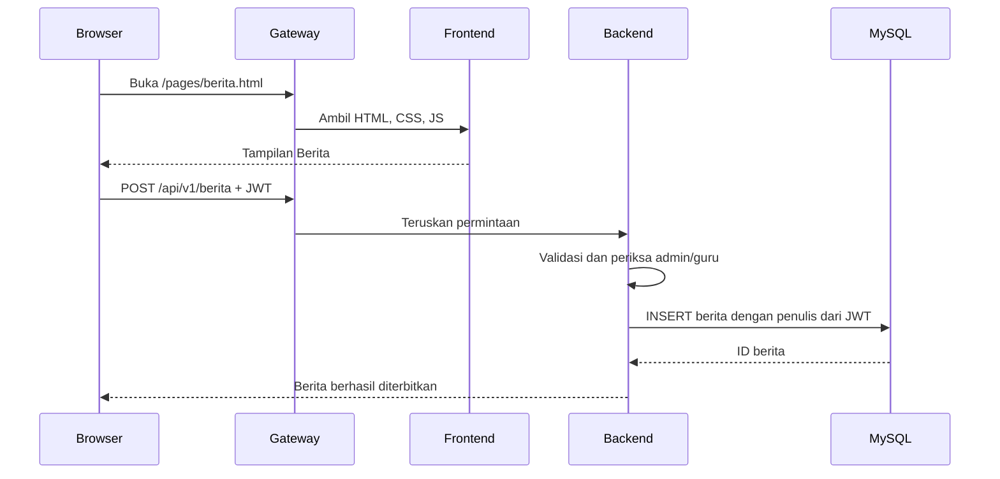

# Fitur Berita: perubahan kode sampai deployment

Halaman: http://127.0.0.1:8080/pages/berita.html. Menu Berita tersedia pada dashboard admin, guru, siswa, dan orang tua.

## Perilaku fitur

- Semua pengguna yang sudah login bisa melihat daftar, mencari, membuka detail, dan berpindah halaman.
- Admin bisa membuat, mengedit, dan menghapus seluruh berita.
- Guru bisa membuat berita serta mengedit/menghapus tulisannya sendiri. Backend menolak guru yang mencoba mengubah tulisan guru lain.
- Siswa dan orang tua hanya membaca; menampilkan tombol tersembunyi lewat browser tidak memberikan akses tulis karena izin diperiksa lagi di API.
- Judul 5–200 karakter, ringkasan opsional maksimal 300 karakter, isi 10–50000 karakter. Isi dirender sebagai teks biasa agar markup dari penulis tidak dieksekusi sebagai HTML.
- Daftar diurutkan dari terbaru, 9 berita per halaman di UI, maksimal 50 per permintaan API.

| API | Perilaku |
| --- | --- |
| GET /api/v1/berita?search=...&page=1&limit=9 | Cari dan baca daftar |
| GET /api/v1/berita/:id | Baca detail |
| POST /api/v1/berita | Terbitkan; admin/guru |
| PUT /api/v1/berita/:id | Edit; admin/penulis |
| DELETE /api/v1/berita/:id | Hapus; admin/penulis |

## Peran empat container

| Container | Hubungan dengan Berita |
| --- | --- |
| frontend | Menyajikan berita.html, berita.js, berita.css dan menu baru di empat dashboard. Image dibangun ulang untuk memuat file baru. |
| backend | Menjalankan route /api/v1/berita, validasi, JWT, izin, query MySQL, serta migrasi. Image dibangun ulang untuk memuat API baru. |
| database | Tetap memakai MySQL 8.4 dengan volume yang sama. Migrasi menambahkan berita dan schema_migrations tanpa menghapus tabel akademik lama. |
| gateway | Tetap menerima localhost:8080, meneruskan /pages/berita.html dan aset ke frontend serta /api/v1/berita ke backend. Konfigurasi routing umum yang sudah ada mencakup fitur ini. |

## Alur perubahan

1. Buat branch fitur dari main yang bersih. Tambahkan UI, API, migrasi, dan tes pada branch yang sama.
2. Jalankan npm run check dan validasi script lokal. Commit perubahan dan push branch ke GitHub.
3. Buka pull request ke main. CI pada pull request membangun image dan menjalankan tepat empat container di Ubuntu GitHub. PR tidak mempublikasikan image dan tidak mengubah deployment komputer lokal.
4. CI memeriksa halaman/aset, login empat role, izin pembaca/penulis/admin, CRUD Berita, pencarian, pagination, dan validasi. Fixture berita uji dibersihkan setelah pengujian.
5. CI membuat sebuah berita probe, menjalankan migrasi lagi, me-restart backend, lalu memeriksa isi berita tetap sama dan jumlah akun tidak berubah. Probe dihapus dan tes integrasi diulang.
6. Setelah CI PR berhasil, merge ke main. Push hasil merge memicu workflow CI/CD utama dan mengulangi build serta seluruh tes pada commit yang akan dirilis.
7. Image aplikasi yang lolos dipublikasikan ke GHCR dengan tag SHA commit. Keempat image teruji dikemas dalam artifact untuk runner Windows.
8. CD menunggu CI sukses. Runner Windows lokal mengunduh artifact dan menjalankan docker image load; aplikasi tidak dibangun ulang di komputer lokal.
9. Script deploy mempertahankan .env dan volume, lalu menjalankan Compose dengan image commit baru. Backend melakukan migrasi sebelum menerima request. Database lama mendapatkan tabel Berita; data akademik tetap disimpan.
10. CD memeriksa empat container healthy, koneksi database, penanda fitur Berita pada /health, halaman Berita, dan tes HTTP melalui gateway. Hasil release dicatat dalam release.json.

## Migrasi database lama

Mengubah schema.sql saja tidak cukup untuk volume MySQL yang telah berisi data karena script init MySQL hanya berjalan saat database baru diinisialisasi. Karena itu, database/migrate.js menjalankan file SQL berurutan dari database/migrations pada startup server.

Migrasi 001_create_berita.sql hanya menambahkan tabel. Nama dan checksum migrasi dicatat di schema_migrations; migrasi yang sudah diterapkan tidak dijalankan ulang. Advisory lock MySQL mencegah dua backend melakukan migrasi bersamaan. Migrasi gagal membuat backend gagal start sehingga health check dan deploy tidak melaporkan sukses.

Untuk menjalankan migrasi secara manual di backend yang sedang berjalan: docker compose exec backend node database/migrate.js. Untuk instalasi Node langsung: npm run migrate setelah schema awal dibuat.

Jika startup atau pemeriksaan kesiapan di script deploy gagal, image aplikasi release sebelumnya dipulihkan jika tersedia. Tabel Berita yang ditambahkan dibiarkan karena kompatibel dengan kode lama; database tidak dihapus atau di-reset. Ini tidak menjanjikan rollback data atau zero downtime.

Komputer, Docker Desktop, dan runner harus aktif. Sesuai pilihan pengguna, runner dimulai manual setelah login Windows; tidak ada startup task baru.
