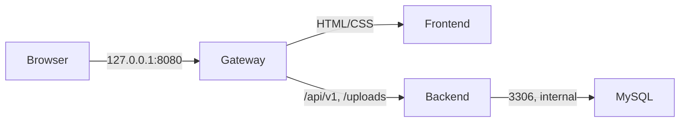

# Docker dan CI/CD lokal

Repo sumber: https://github.com/Frederycho77/PortalAkademikGajahMada

## Empat container

| Layanan | Teknologi | Tugas |
| --- | --- | --- |
| gateway | Nginx unprivileged | Port host 127.0.0.1:8080, meneruskan UI dan API |
| frontend | Nginx unprivileged | Menyajikan HTML/CSS/dashboard dari public/ |
| backend | Node.js 22 + Express | API, JWT, akses data, uploads |
| database | MySQL 8.4 LTS | Schema, trigger, data persisten |

Frontend dan backend memakai image terpisah. Gateway membuat URL API relatif `/api/v1` tetap berfungsi. Database tidak membuka port host dan hanya backend yang bergabung ke jaringan data internal. Backend/frontend/gateway berjalan sebagai pengguna non-root. Semua layanan memiliki health check; `/health` memeriksa tabel users di MySQL. Data MySQL dan uploads disimpan dalam named volume.



## Menjalankan manual

Gunakan Docker Desktop dengan Linux containers dan PowerShell dari folder repo:

```powershell
./scripts/init-env.ps1
docker compose config --quiet
docker compose up -d --build --wait --wait-timeout 240
npm run test:smoke
docker compose ps
```

Buka http://127.0.0.1:8080. `.env` dibuat dengan password database dan JWT acak; file ini tidak di-commit. `SEED_DEMO_DATA=true` hanya untuk demo lokal: seed dijalankan saat tabel users kosong, tidak diulang setiap deploy, dan tidak menimpa password yang sudah diubah. Schema hanya dijalankan pada volume database baru.

| Username demo | Password | Role |
| --- | --- | --- |
| admin_portal | Admin@1234 | admin |
| guru_budi | Guru@1234 | guru |
| siswa_rizky | Siswa@1234 | siswa |
| ortu_ahmad | Ortu@1234 | orang_tua |

Hash admin placeholder dari sumber telah dihapus agar seed menghasilkan bcrypt yang benar. Perintah seed sekarang mengembalikan exit code gagal jika seeding gagal. Login rate limiter diperbaiki agar memakai prefix `/api/v1/auth/login`.

Untuk menghentikan layanan tanpa menghapus database: `docker compose down`. Jangan gunakan `down -v` jika data masih diperlukan. Untuk instalasi tanpa akun contoh, set `SEED_DEMO_DATA=false` sebelum startup pertama, lalu siapkan akun melalui proses provisioning sendiri. Menonaktifkan seed setelah startup tidak menghapus akun yang sudah ada.

## Pipeline GitHub Actions

Workflow `.github/workflows/ci-cd.yml` berjalan pada push main, pull request ke main, dan workflow_dispatch.

1. CI memakai GitHub-hosted Ubuntu 24.04; memeriksa JavaScript backend serta script inline frontend.
2. Membuat konfigurasi CI sementara dengan secret acak; build tiga image aplikasi dan mengambil MySQL resmi.
3. Menjalankan tepat empat container dan menunggu semuanya sehat.
4. Tes integrasi melalui gateway: UI/CSS/dashboard, health database, login empat role, endpoint terlindungi, kredensial salah, serta pembatasan API admin.
5. Restart backend, cek jumlah user tidak berubah, lalu ulangi tes integrasi.
6. Hanya push main/manual main yang mempublikasikan image teruji ke GHCR dengan tag SHA commit. Pull request tidak publish dan tidak deploy.
7. CI juga menyimpan keempat image teruji (termasuk MySQL) dalam artifact `tested-docker-images-SHA` selama satu hari. CD berjalan di runner Windows lokal berlabel `portal-akademik`, mengunduh artifact dari run yang sama, dan menjalankan `docker image load`. Tidak ada build ulang pada komputer lokal.
8. CD menjalankan empat container, memeriksa health/UI, dan mencatat release. Kegagalan startup/readiness mengembalikan image aplikasi release sebelumnya jika tersedia. Tidak ada migrasi database destruktif otomatis.

Tidak perlu Docker Hub token atau PAT dalam repo. Publish GHCR memakai `GITHUB_TOKEN` dengan izin packages terbatas. Deployment lokal memakai artifact dari CI sehingga tidak memerlukan login registry pada Windows. Untuk menjalankan ulang deployment setelah artifact kedaluwarsa, jalankan workflow penuh melalui workflow_dispatch agar CI membuat artifact baru. Jangan membagikan folder konfigurasi runner yang berisi identitas runner.

## Deployment persisten pada komputer ini

Runner dipasang di `D:\mikroskil\DevOps\.devops-tools\actions-runner`. Konfigurasi deploy, secret lokal, salinan schema, dan penanda release disimpan terpisah di `D:\mikroskil\DevOps\deployments\portal-akademik`. Checkout yang dibersihkan Actions tidak menghapus `.env` deployment. Secret dibuat satu kali dan digunakan lagi agar akses volume database tetap konsisten.

Komputer, Docker Desktop, dan proses runner harus hidup saat CD berjalan. Runner ini hanya dipakai untuk job deployment main; pull request dijalankan pada runner GitHub. Workflow deploy memakai PowerShell bawaan Windows; Node.js 22 dan Docker CLI harus tersedia di PATH runner.

Untuk memulai runner yang sudah didaftarkan:

```powershell
& 'D:\mikroskil\DevOps\.devops-tools\actions-runner\run.cmd'
```

Jika runner berhenti, CD akan tetap queued sampai runner online. Tidak ada klaim deploy berhasil hanya karena build CI hijau; periksa kedua job CI dan deploy di halaman Actions.

## Verifikasi dan pemulihan

```powershell
npm run check
docker compose ps
Invoke-RestMethod http://127.0.0.1:8080/health
npm run test:smoke
```

Tes penuh menggunakan akun demo; pada deployment yang password akunnya telah diubah, gunakan tes readiness yang tidak memerlukan password:

```powershell
node --test '--test-name-pattern=gateway reaches|protected APIs' tests/smoke.test.js
```

Artefak `docker-diagnostics` menyimpan status/log CI selama tujuh hari. Jangan mencetak `docker compose config` tanpa `--quiet` karena output penuh memuat hasil substitusi secret.

Jika Docker Desktop Windows gagal dengan `engine.sock`/`dockerInference` yang tersisa, simpan folder runtime bermasalah sebagai cadangan ketika semua proses Docker telah berhenti. Hindari factory reset, penghapusan volume, unregister WSL, dan penghapusan VHDX. Referensi laporan masalah: https://github.com/docker/desktop-feedback/issues/536 dan dokumentasi: https://docs.docker.com/desktop/troubleshoot-and-support/troubleshoot/.
